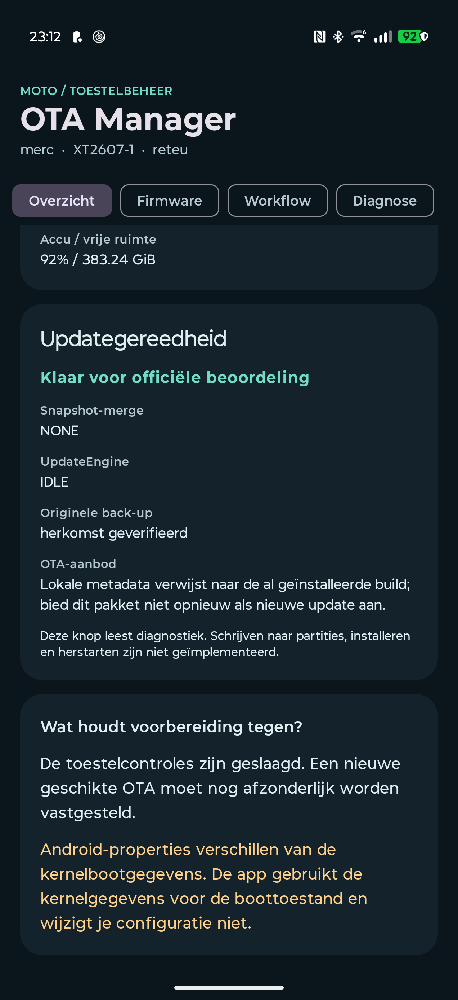

# Moto OTA Manager

**0.2.0-safe** is een Kotlin/Jetpack Compose-app voor uitlezende diagnostiek en begeleiding op **Motorola XT2607-1 / merc / reteu**. De echte Android 17-build `A171WMH.44-25` is onderzocht: slot `_b`, werkende Magisk 31.1-root, geen actieve snapshot-merge en een live enginecallback met `IDLE`. De huidige stockback-up is onafhankelijk gekoppeld aan het ondertekende historische OTA-doelmanifest. Zie [de toestelmetingen en hun grenzen](docs/DEVICE-VALIDATION.md).

**Deze release schrijft geen partities, installeert geen OTA, patcht geen Magisk en herstart niet.** Daarvoor zijn op dit toestel geen bewezen stabiele externe Motorola-/Magisk-interfaces vastgesteld. De app biedt de best onderbouwde veilige fallback: diagnostiek, pakketonderzoek en begeleiding naar de officiële apps. Een geslaagde build bewijst geen veilige OTA-installatie.

## Direct gebruiken

1. Installeer de geleverde `moto-ota-manager-debug.apk` handmatig via Android. De meegeleverde APK is een debugbuild.
2. Open de app. De eerste controle leest alleen niet-geprivilegieerde eigenschappen.
3. Verleen voor uitgebreide diagnostiek vooraf toegang aan Moto OTA Manager in **Magisk → Superuser**. Magisk 31.1 heeft reactieve rootprompts verwijderd.
4. Kies **Controleer en bereid update voor → Start uitlezen**. Iedere nieuwe controle leest de actuele slot-, snapshot- en enginetoestand; historische succesvolle metingen worden niet als actuele gereedheid ingevuld.
5. Open **Firmware** voor de officiële updater of een handmatig gekozen OTA-ZIP. De onderzochte lokale downloadjob betreft `payload_metadata.bin` van de al geïnstalleerde update: metadata-only, geen nieuwe OTA-download.
6. Onderzoek een geselecteerd pakket en kies afzonderlijk **Verifieer officiële ondertekening**. De implementatie gebruikt `RecoverySystem.verifyPackage` tegen de echte toesteltruststore. De historische OTA is zowel onafhankelijk op de host als positief met die echte Android-API op de telefoon geverifieerd, zonder installatie. De resultaten staan in het buildrapport.
7. Exporteer via **Diagnose** desgewenst een lokaal rapport. De veilige simulatie werkt volledig los van het echte workflowjournaal.

Lees vóór gebruik de [veiligheidsgrenzen](docs/SAFETY.md) en [toesteltestchecklist](docs/MANUAL-TESTS.md). Na terugkeer uit Magisk of Motorola kies je opnieuw uitlezen. De app bedient hun knoppen niet.



## Werkende implementaties en hun bewijsgrenzen

| Onderdeel | Implementatie | Bewijs en grens |
|---|---|---|
| Toestelprofiel | Getprops, technisch SKU, kernelbootconfig en bronconflicten | XT2607-1, merc, reteu, Android 17 en huidige build werkelijk gemeten; marketingnaam alleen is geen SKU |
| Root/Magisk | Expliciet aangevraagde root, vaste allowlist, timeouts, aparte stdout/stderr | UID 0 en versiecode 31100 bevestigd; ontbrekende gewone appproperties worden pas na rootverlening opnieuw gelezen |
| A/B en Virtual A/B | Toolprobes plus begrensde directe metadata met CRC-/formaatcontrole | Tools ontbreken op dit toestel; geldige boot-controlmetadata bevestigt succesvolle slot b, snapshotbronnen bevestigen `NONE` |
| UpdateEngine | Tijdelijke callback; SDK 37-roothelper met echte frameworkbindings als fallback | Live `IDLE` bevestigd; helper doet alleen `bind`/`unbind`, geen payload- of cleanupaanroep |
| Magisk-back-ups | Volledige begrensde gzip, uitgepakte omvang, v4-header, hashes en actuele referentie | Werkelijke 8 MiB-back-up matcht het geauthenticeerde Android 17-doelmanifest |
| Lokale imagekluis | SAF-import, strikte gzip/imagevalidatie en `VerifiedStockCatalog` | Referentie uitsluitend voor exacte huidige build/fingerprint/profiel én passende OTA-trustanchor; andere builds blijven onbewezen |
| Firmwaredetectie | Getypeerde, begrensde parser voor de werkelijk gevonden preference-envelop | Huidige metadata is historisch en verwijst naar de geïnstalleerde build; geen geverifieerde publieke Motorola-discovery-API |
| Download | Expliciet verzoek, HTTPS-hostallowlist, geen redirects, lengte/ruimte, atomair opslaan | Actuele geldige Motorola-link en servergedrag |
| OTA-validatie | ZIP, A/B-metadata, exacte bronidentiteit, model/kanaal, CrAU-v2, hashes en datum/SPL | Historische handtekening en payloadhashes onafhankelijk bevestigd; afwijkende OEM-fingerprintnamespaces vereisen review, oude doelbuild is al geïnstalleerd |
| Workflow | Atomair journaal, procesherstel, onafhankelijke waarnemingen, rollback/root/mergecontrole | Echte updateketen is niet uitgevoerd |
| Simulatie | Synthetische demo en mocktests, permanent gelabeld | Levert nooit toestemming voor een echte update |

Een Magisk-directory, losse SHA-256 of naam `boot.img.gz` bewijst op zichzelf geen stockherkomst. De nieuwe ingebouwde referentie steunt op volledige back-upbytes, het geauthenticeerde OTA-doelmanifest en de exact gemeten huidige identiteit. Zij omvat geen imagebytes en geldt niet voor toekomstige builds. Ook `cid50`, een URL-hostnaam of `release-keys` in een bestandsnaam bewijst geen geschikte officiële firmware. De historische Android 16-image blijft ongeschikt als stock voor de huidige build.

Zonder onafhankelijke actuele stockherkomst en kanaalbewijs blijft het echte voorbereidingsjournaal geblokkeerd. Deze release bevat bewust geen knop die een onbewezen image toch herstelbaar verklaart. De handmatige handleiding blijft beschikbaar.

## Reproduceerbaar bouwen

Benodigd: JDK 17, Android SDK Platform 35 en Build Tools 35.0.0. De repository bevat de echte Gradle Wrapper 8.11.1, AGP 8.9.2, Kotlin/Compose-plugin 2.1.20 en vastgezette dependencies. `minSdk=33`, `targetSdk=35`. Android 17 kan een app met dit target uitvoeren; dat is geen claim van platformbrede OTA-compatibiliteit.

Maak lokaal een genegeerde `local.properties` met bijvoorbeeld `sdk.dir=C:/Android/Sdk`, of stel `ANDROID_HOME` in.

```powershell
$env:JAVA_HOME = 'C:\pad\naar\jdk-17'
.\gradlew.bat :core:test :app:testDebugUnitTest :app:lintDebug :app:assembleDebug :app:assembleDebugAndroidTest --console=plain
```

```sh
./gradlew :core:test :app:testDebugUnitTest :app:lintDebug :app:assembleDebug :app:assembleDebugAndroidTest --console=plain
```

De app-APK verschijnt in `app/build/outputs/apk/debug/app-debug.apk`. JUnit-XML en HTML staan onder `core/build/test-results`, `core/build/reports/tests`, `app/build/test-results` en `app/build/reports`. De GitHub Actions-workflow voert deze controles opnieuw uit en bevat een aparte emulatorjob voor de veilige UI-tests.

De ontwikkelsessie gebruikt een geïsoleerde toolchain/cache onder de werkmap, zonder bestaande Android-projecten of globale Java-instellingen te wijzigen. De meegeleverde APK is debug-ondertekend; een openbare productie-uitgave vereist een eigen beheerde releasesleutel.

## Architectuur

```text
app/  Kotlin + Compose Material 3
  MotoViewModel           expliciete acties, waarnemingen en lokale toestand
  platform/DeviceInspector    getprop, accu, ruimte, beperkte rootprobes
  platform/ReadOnlyShell      vaste allowlist; geen vrije shellinvoer
  platform/ObservationParsers snapshot/engine/XML met fail-closed parsing
  platform/MetadataObservations begrensde boot-/snapshotmetadata en bronvergelijking
  platform/MotorolaMetadataParser typed cachebewijs; metadata-only versus OTA-ZIP
  platform/OfficialApps       system-only resolver, expliciete officiële componenten
  rootprobe/EngineProbe       aparte SDK 37-rootcallback, uitsluitend bind/unbind
  rootprobe/FirmwareSignatureProbe bestaande Motorola-ZIP uitsluitend lezen en verifiëren
  platform/FirmwareFiles     SAF, HTTPS en toestelcertificaten
  platform/WorkflowStore     AtomicFile-journaal, geen simulatiepersistentie
core/ pure Kotlin JVM
  BackupValidator    gzip, v4 init_boot-header, exacte omvang en stockreferentie
  VerifiedStockCatalog exact geauditeerd profiel plus toestel-OTA-trustanchor
  ReadOnlyMetadata   CRC, boot-control, Virtual A/B en snapshot-protobuf
  FirmwareValidator  ZIP/metadata, fingerprint, antirollback en hashes
  PackageTransfer    begrensde overdracht, fsync, atomische commit en cleanup
  FirmwareDiscovery  lokaal cachebewijs versus officieel aanbod/externe claim
  Readiness          actuele, consistente observaties en conservatieve blokkades
  Workflow           bewijsafhankelijke toestanden en herstel na proces/herstart
  Privacy            export op basis van een kleine veldallowlist
```

De app vraagt uitsluitend `INTERNET`; bestanden gaan via de Android-bestandskiezer. Er is geen brede opslagpermission, accessibility-automatisering, platformhandtekening of algemene shellconsole. De expliciet aangevraagde roothelper gebruikt beperkte reflectie voor `ServiceManager`, uitsluitend op SDK 37 en met de werkelijk geladen frameworkinterfaces; geweigerde toegang blijft onbekend. Zij wijzigt geen hidden-API-beleid of SELinux-instelling. De twee vaste Motorola-preference-uitlezingen en de expliciete verificatie van een bestaande ZIP in Motorola's map gebruiken de globale Magisk-mountnamespace met `su --target 0`, uitsluitend voor de nieuwe uitlezende subprocess.

De officiële updater wordt met `MATCH_SYSTEM_ONLY` gevonden, vereist een positieve prioriteit en een ingeschakelde geëxporteerde Motorola-systeemactivity en krijgt een expliciete component. De actionstring staat letterlijk in de code omdat de publieke Settings-constante pas vanaf 36.1 bestaat en dit project tegen SDK 35 bouwt. Ontbrekende updater of verborgen Magisk-installatie geeft handmatige navigatie. Er is geen automatische telemetrie, firmware-scraping, notificatiepolling of upload.

AndroidX voegt daarnaast een eigen signaturepermission voor niet-geëxporteerde dynamische receivers toe. Dat is geen brede toestel- of opslagtoestemming.

## Documentatie

- [Concrete buildresultaten en testbewijs](docs/BUILD-REPORT.md)
- [Werkelijke toestelmetingen, OTA-oorzaak en stockherkomst](docs/DEVICE-VALIDATION.md)
- [Onderzoek en haalbaarheidsmatrix met primaire bronnen](docs/RESEARCH.md)
- [Alle twintig gevraagde testscenario's](docs/TEST-MATRIX.md)
- [Veiligheid](docs/SAFETY.md), [bekende beperkingen](docs/KNOWN-LIMITATIONS.md)
- [Compatibiliteit](docs/COMPATIBILITY.md), [Android 18-roadmap](docs/ROADMAP.md)
- [Handmatige toesteltestchecklist](docs/MANUAL-TESTS.md)

Oorspronkelijke projectcode: MIT; zie [LICENSE](LICENSE) en [NOTICE](NOTICE) voor de overgenomen componenten en hun voorwaarden. Dit onafhankelijke project is niet uitgegeven of goedgekeurd door Motorola of Magisk.
