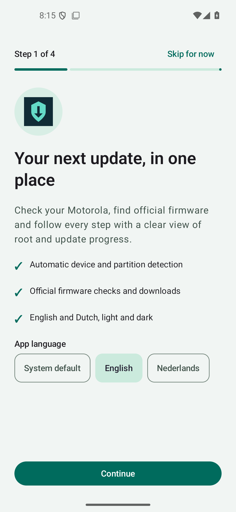
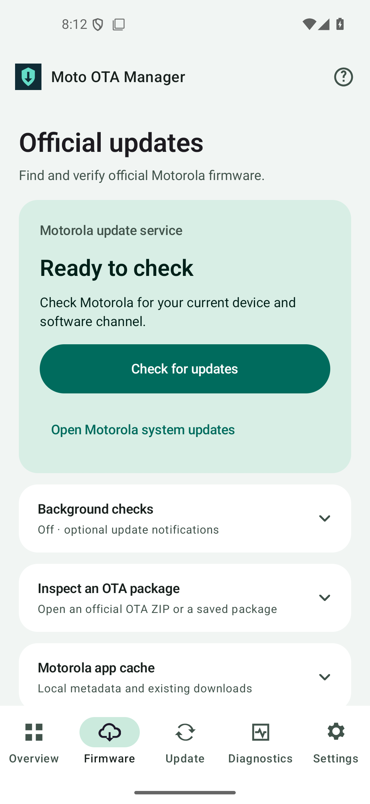

<div align="center">

# Moto OTA Manager

**Understand your Motorola. Prepare the update. Keep each step accountable.**

Kotlin · Jetpack Compose · Android 13+ · English / Nederlands · MIT

[Download 1.0.1](https://github.com/JustMLC4real/moto-ota-manager/releases/tag/v1.0.1) · [Get started](docs/INSTALLATION.md) · [Compatibility](docs/COMPATIBILITY.md) · [Build evidence](docs/BUILD-REPORT.md) · [Nederlandse README](README.nl.md)

</div>

Moto OTA Manager **1.0.1** brings device diagnostics, firmware inspection, resumable downloads and a persistent guided update workflow into one Android app. It was developed around the Motorola Edge 70 Pro **XT2607-1 / merc / reteu** and evaluates other Motorola devices from their observed capabilities.

The app separates a downloaded file, an authenticated package, a user-reported step and a verified device observation. An unknown result stays unknown. One reviewed start scopes subsequent actions, including the displayed partition writes, root-preservation steps and reboot; each action still needs fresh evidence. Unsupported or uncertain transitions pause. Android and Motorola retain their own update verification checks.

## A clear view of each step

| First-run guide | Official firmware | Dutch · dark appearance |
|:---:|:---:|:---:|
|  |  |  |

Actual screenshots of the signed release on a disposable Android emulator. Device values in the [overview](docs/images/overview-en.png) belong to that emulator. The [complete workflow demonstration](docs/images/simulation-nl-dark.png) is explicitly simulated; no phone update is shown.

## What you get

| Feature | What it actually does |
|---|---|
| Device diagnostics | Reads device/build/channel identity, battery, space, root, Magisk and module inventory. Compares available boot and security sources. |
| A/B and snapshots | Observes slots, checked boot metadata, snapshot state and read-only UpdateEngine callbacks. Active, conflicting or unknown state blocks preparation. |
| Firmware inspection | Examines ZIP/A/B metadata, source and target identity, payload headers and hashes. Checks whole-file signatures against certificates read from the device. |
| Firmware downloads | Downloads an explicitly selected reference from an allowed Motorola HTTPS source, with progress, pause, resume and cancellation. Incomplete bytes never become the selected package. |
| Local package import | Copies a selected existing Motorola ZIP into private storage, with bounded discovery, stable-file checks and full hash readback. The original stays untouched. |
| Update information | A source-derived Motorola-CDS online check after explicit data-sharing consent, with local-cache fallback and optional deduplicated informational notifications. |
| Stock recovery | Prepares a verified stock-image restore only when the current device, partition, provenance and runtime gates pass. A real write must fall within the reviewed run scope and pass fresh checks at the actual write boundary. |
| One-start update | Coordinates official CDS selection, complete package validation, current stock restore, Android OTA application, verified inactive-slot Magisk and controlled restart. Missing prerequisites stop the route with recovery evidence. [Technical boundaries](docs/DIRECT-OTA.md). |
| Guided workflow | Persists expectations and observations separately. OTA, Magisk, reboot, target boot and snapshot merge are distinct steps. Interrupted operations are inspected instead of replayed. |
| Private diagnostics | Exports an allowlisted local report on request. No automatic telemetry, account collection or raw-log upload. |
| Simulation | Exercises the workflow with small private test files. Simulated OTA, root, slots and reboot are visibly identified. |

## First run

1. Install a verified APK for your architecture; open the setup screen and choose English or Dutch.
2. Start with diagnostics. Root is optional for basic identity; grant this app access in Magisk when you choose root diagnostics.
3. Review the measured capabilities. A marketing name or Android version alone cannot unlock a write action.
4. Use the primary Motorola-CDS check after reading its data-sharing disclosure. The official updater and local package inspection remain fallbacks when a suitable complete offer cannot be established.
5. Review the target, displayed checks and [safety guide](docs/SAFETY.md), then the complete start scope. Qualified phases do not need separate confirmations; the app proceeds only within that scope and with current evidence.

Notifications and background checking are optional. They are off until you opt in. Language can also be changed through Android's per-app language settings.

[Installation and setup](docs/INSTALLATION.md) · [Workflow and recovery](docs/UPDATE-WORKFLOW.md) · [CDS provider](docs/CDS-PROVIDER.md) · [Integration decisions, including avbroot](docs/INTEGRATION-DECISIONS.md) · [Monitoring and downloads](docs/MONITORING-AND-DOWNLOADS.md)

## Supported does not mean assumed

The app requires **Android 13 / API 33 or newer** and ships native libraries for **arm64-v8a** and **x86_64**. General diagnostics and official-updater navigation have broader coverage than stock writes or Motorola's internal package paths.

Capability checks identify the measured boot layout, current identity, root status and available evidence. The write adapter targets the reviewed **API 33–37** range and **Magisk 31.1**, with authenticated stock provenance and fresh runtime checks. That is an implementation boundary, not a claim that every Motorola firmware has been physically tested. Future Android versions retain diagnostics where possible; unsupported critical adapters stay blocked. [Exact limits](docs/COMPATIBILITY.md).

The Edge 70 Pro reference profile has historical read-only hardware evidence. New write paths, other models and the complete future OTA/root-preservation chain must be qualified on their actual devices. A successful emulator test or APK build does not prove a successful physical OTA. [Build and test evidence](docs/BUILD-REPORT.md) · [Historical hardware observations](docs/DEVICE-VALIDATION.md).

Motorola's normal updater is the fallback when no authenticated, suitable local package is established. Local staging is a separate, potentially consequential OEM handoff: signed channel proof is mandatory, and a valid ZIP signature or Motorola host alone cannot supply it. Unsupported Magisk or OEM transitions must pause rather than fabricate success. [Known limitations](docs/KNOWN-LIMITATIONS.md).

## Build from source

Install JDK 17, Android SDK Platform 35, Build Tools 35.0.0, NDK 27.2.12479018 and CMake 3.22.1. Use the checked-in Gradle 8.11.1 wrapper. Keep your SDK path in an untracked `local.properties` or `ANDROID_HOME`.

```sh
./gradlew :core:test :app:testDebugUnitTest :app:lintDebug :app:assembleDebug :app:assembleDebugAndroidTest --no-daemon --console=plain
```

On Windows, use `gradlew.bat`. The debug APK is `app/build/outputs/apk/debug/app-debug.apk`.

Run instrumentation only on an explicitly selected disposable emulator:

```sh
ANDROID_SERIAL=emulator-5554 ./gradlew :app:connectedDebugAndroidTest --no-daemon
```

The physical-device validation test is opt-in and is skipped by default. Never select your phone for the emulator suite. [Test matrix](docs/TEST-MATRIX.md).

Release builds are non-debuggable, signed and independently checked. Version 1.0.1 ships the complete runtime without code shrinking: optimized release instrumentation exposed shared-library ABI failures. R8 remains opt-in for further qualification. Signing requires your own private release key; no key is committed and unsigned CI output is not an installable release. [Release guide](docs/RELEASING.md) · [Release engineering](docs/RELEASE-ENGINEERING.md).

## Repository

| Path | Contents |
|---|---|
| `app/` | Compose UI, Android adapters, WorkManager, private storage, restricted root helpers and native publication binding |
| `core/` | Pure Kotlin policies, parsing, transfer engine, capability checks and durable workflow contracts |
| `docs/` | Setup, safety, research, architecture and concrete build/test evidence; Dutch user guides under `docs/nl/` |
| `evidence/` | Reviewed build/test records and separately labelled historical device evidence |
| `.github/` | Build/emulator CI, protected manual release signing, dependency updates and issue templates |

Contributions: [CONTRIBUTING](CONTRIBUTING.md). Security reports: [SECURITY](SECURITY.md). Licensed under [MIT](LICENSE); included AOSP interfaces and third-party attributions are listed in [NOTICE](NOTICE). No Motorola firmware or Magisk binary is redistributed. This is an independent project, not an official Motorola or Magisk product.
