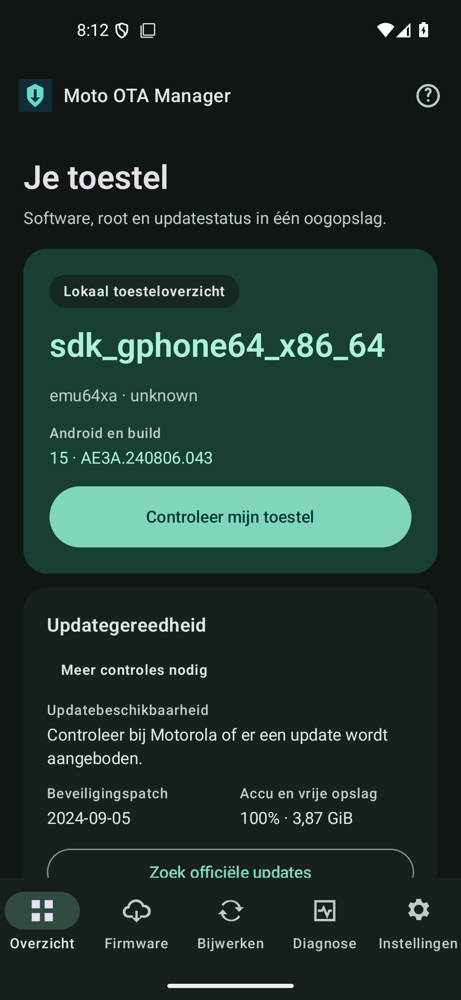
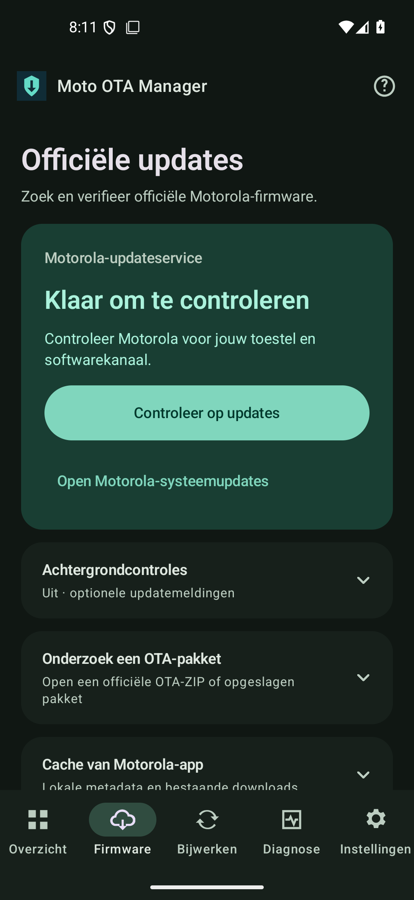
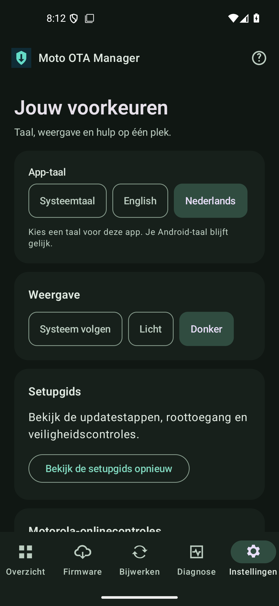

<div align="center">

# Moto OTA Manager

**Begrijp je Motorola. Bereid de update voor. Controleer iedere stap.**

Kotlin · Jetpack Compose · Android 13+ · English / Nederlands · MIT

[Download 1.0.1](https://github.com/JustMLC4real/moto-ota-manager/releases/tag/v1.0.1) · [Aan de slag](docs/nl/INSTALLATION.md) · [Compatibiliteit](docs/nl/COMPATIBILITY.md) · [Buildbewijs](docs/BUILD-REPORT.md) · [English README](README.md)

</div>

Moto OTA Manager **1.0.1** combineert toesteldiagnostiek, firmwareonderzoek, hervatbare downloads en een duurzame begeleide updateworkflow in één Android-app. De app is ontwikkeld rond de Motorola Edge 70 Pro **XT2607-1 / merc / reteu** en beoordeelt andere Motorola-toestellen op hun werkelijk gemeten mogelijkheden.

Een ontvangen bestand, geauthenticeerd pakket, handmatig gemelde stap en geverifieerde toestelobservatie zijn afzonderlijke resultaten. Onbekend blijft onbekend. Eén beoordeelde start begrenst volgende handelingen, inclusief de getoonde partitieschrijfacties, rootbehoud en herstart; iedere actie vereist nog steeds vers bewijs. Niet-ondersteunde of onzekere overgangen pauzeren. Android en Motorola behouden hun eigen updatecontroles.

## Iedere stap duidelijk in beeld

| Overzicht | Officiële firmware | Instellingen |
|:---:|:---:|:---:|
|  |  |  |

Echte screenshots van de getekende release op een wegwerpemulator. De toestelwaarden in het [overzicht](docs/images/overview-nl-dark.png) horen bij die emulator. De [volledige workflowdemonstratie](docs/images/simulation-nl-dark.png) is zichtbaar gesimuleerd; hier is geen telefoonupdate uitgevoerd.

[Bekijk de animaties](https://github.com/JustMLC4real/moto-ota-manager/releases/download/v1.0.1/moto-ota-manager-1.0.1-preview.mp4) · [Wijzigingen in 1.0.1](docs/RELEASE-NOTES-1.0.1.md)

## Wat je krijgt

| Functie | Werkelijk gedrag |
|---|---|
| Toesteldiagnostiek | Leest toestel/build/kanaal, accu, opslag, root, Magisk en modules. Vergelijkt beschikbare boot- en beveiligingsbronnen. |
| A/B en snapshots | Observeert slots, gecontroleerde bootmetadata, snapshots en uitlezende UpdateEngine-callbacks. Actieve, tegenstrijdige of onbekende toestand blokkeert voorbereiding. |
| Firmwareonderzoek | Controleert ZIP/A/B-metadata, bron/doel, payloadheader en hashes. Controleert de volledige ZIP-handtekening tegen werkelijk gelezen toestelcertificaten. |
| Firmwaredownloads | Downloadt een expliciet gekozen verwijzing van een toegestane Motorola-HTTPS-bron, met voortgang, pauze, hervatten en annuleren. Onvolledige bytes worden nooit het geselecteerde pakket. |
| Lokaal importeren | Kopieert een gekozen bestaande Motorola-ZIP naar private opslag, met begrensde ontdekking, stabiele-bestandscontrole en volledige terughash. De bron blijft onaangeroerd. |
| Update-informatie | Brongebaseerde Motorola-CDS-onlinecontrole na expliciete deeltoestemming, met lokale-cacheterugval en optionele informatieve meldingen zonder herhaling. |
| Stockherstel | Bereidt geverifieerd stockherstel alleen voor als toestel, partitie, herkomst en runtimecontroles voldoen. Echt schrijven moet binnen de beoordeelde startintentie vallen en bij uitvoering aan verse controles voldoen. |
| Eén start | Coördineert officiële CDS-selectie, volledige pakketvalidatie, actueel stockherstel, Android-OTA-installatie, gecontroleerde Magisk-installatie op de inactieve slot en herstart. Ontbrekende voorwaarden stoppen de route met herstelbewijs. [Technische grenzen](docs/nl/DIRECT-OTA.md). |
| Begeleide workflow | Bewaart verwachtingen en observaties apart. OTA, Magisk, herstart, doelboot en snapshotmerge zijn losse stappen. Onderbrekingen worden onderzocht in plaats van opnieuw afgespeeld. |
| Private diagnostiek | Exporteert op verzoek een lokaal rapport met toegestane velden. Geen automatische telemetrie, accountverzameling of ruwe-logupload. |
| Simulatie | Doorloopt de workflow met kleine private testbestanden. Gesimuleerde OTA, root, slots en herstart zijn duidelijk gemarkeerd. |

## Eerste gebruik

1. Installeer een gecontroleerde APK voor je architectuur, open de instellingen voor eerste gebruik en kies Nederlands of Engels.
2. Begin met diagnostiek. Root is optioneel voor basisidentiteit; verleen deze app Magisk-toegang wanneer je rootdiagnostiek kiest.
3. Bekijk de gemeten mogelijkheden. Alleen een marketingnaam of Android-versie ontgrendelt geen schrijfhandeling.
4. Gebruik de primaire Motorola-CDS-controle nadat je de gedeelde gegevens hebt gelezen. De officiële updater en lokale pakketinspectie blijven terugval als een geschikt volledig aanbod niet bewezen kan worden.
5. Bekijk doel, controles en [veiligheidsgids](docs/nl/SAFETY.md) en lees de volledige startreikwijdte. Geschikte fases vragen geen losse bevestigingen; de app gaat alleen binnen die reikwijdte en met actueel bewijs door.

Meldingen en achtergrondcontrole zijn optioneel en staan uit tot je ze inschakelt. De taal is ook via de Android-instelling voor apptalen te wijzigen.

[Installatie en eerste gebruik](docs/nl/INSTALLATION.md) · [Workflow en herstel](docs/nl/UPDATE-WORKFLOW.md) · [CDS-provider](docs/nl/CDS-PROVIDER.md) · [Integratiekeuzes, inclusief avbroot](docs/nl/INTEGRATION-DECISIONS.md) · [Monitoring en downloads](docs/nl/MONITORING-AND-DOWNLOADS.md)

## Ondersteuning volgt bewijs

De app vereist **Android 13 / API 33 of nieuwer** en bevat native bibliotheken voor **arm64-v8a** en **x86_64**. Algemene diagnostiek en het openen van de officiële updater hebben een breder bereik dan stockschrijven of interne Motorola-pakketmappen.

De app beoordeelt de gemeten bootindeling, identiteit, root en beschikbare bewijzen. De schrijfadapter richt zich op het onderzochte bereik **API 33–37** en **Magisk 31.1**, met geauthenticeerde stockherkomst en verse runtimecontroles. Dit beschrijft de implementatiegrens en beweert niet dat iedere Motorola-firmware fysiek is getest. Op toekomstige Android-versies blijft diagnostiek waar mogelijk beschikbaar; niet-ondersteunde kritieke adapters blijven geblokkeerd. [Exacte grenzen](docs/nl/COMPATIBILITY.md).

Het Edge 70 Pro-referentieprofiel heeft historisch uitlezend toestelbewijs. Nieuwe schrijfhandelingen, andere modellen en de volledige toekomstige OTA/rootbehoudketen vereisen kwalificatie op het betreffende toestel. Een geslaagde emulatorproef of APK-build bewijst geen geslaagde fysieke OTA. [Build- en testbewijs](docs/BUILD-REPORT.md) · [Historische toestelobservaties](docs/DEVICE-VALIDATION.md).

Zonder bewezen geschikt lokaal pakket blijft Motorola's normale updater de terugvalroute. Lokaal klaarzetten is een afzonderlijke OEM-overdracht die meteen verwerking kan uitlokken: ondertekend kanaalbewijs is verplicht; een geldige ZIP-handtekening of Motorola-host vervangt dat niet. Niet-ondersteunde Magisk- of OEM-overgangen moeten pauzeren in plaats van succes te verzinnen. [Bekende beperkingen](docs/nl/KNOWN-LIMITATIONS.md).

## Zelf bouwen

Installeer JDK 17, Android SDK Platform 35, Build Tools 35.0.0, NDK 27.2.12479018 en CMake 3.22.1. Gebruik de meegeleverde Gradle 8.11.1-wrapper. Bewaar je SDK-pad in een niet-ingecheckte `local.properties` of `ANDROID_HOME`.

```sh
./gradlew :core:test :app:testDebugUnitTest :app:lintDebug :app:assembleDebug :app:assembleDebugAndroidTest --no-daemon --console=plain
```

Gebruik op Windows `gradlew.bat`. De debug-APK staat in `app/build/outputs/apk/debug/app-debug.apk`.

Voer instrumenttests uitsluitend op een expliciet gekozen wegwerpemulator uit:

```sh
ANDROID_SERIAL=emulator-5554 ./gradlew :app:connectedDebugAndroidTest --no-daemon
```

De fysieke validatietest vereist aparte opt-in en wordt standaard overgeslagen. Selecteer je telefoon nooit voor de emulatorsuite. [Testmatrix](docs/TEST-MATRIX.md).

Releasebuilds zijn niet-debuggable, ondertekend en afzonderlijk gecontroleerd. Versie 1.0.1 bevat de volledige runtime zonder codeverkleining: geoptimaliseerde release-instrumentatie toonde gedeelde-library-ABI-fouten aan. R8 blijft optioneel voor verdere kwalificatie. Ondertekenen vereist je eigen private releasesleutel; er staat geen sleutel in de bron en unsigned CI-uitvoer is geen installeerbare release. [Releasehandleiding](docs/nl/RELEASING.md) · [Release-engineering](docs/RELEASE-ENGINEERING.md).

## Repository

| Pad | Inhoud |
|---|---|
| `app/` | Compose-UI, Android-adapters, WorkManager, private opslag, beperkte roothelpers en native publicatiebinding |
| `core/` | Pure Kotlin-beleid, parsers, transferengine, mogelijkheden en duurzame workflowcontracten |
| `docs/` | Eerste gebruik, veiligheid, onderzoek, architectuur en concreet build/testbewijs; Nederlandse gebruikersgidsen onder `docs/nl/` |
| `evidence/` | Beoordeelde build/testrecords en afzonderlijk gelabeld historisch toestelbewijs |
| `.github/` | Build/emulator-CI, beschermde handmatige releaseondertekening, dependency-updates en issuetemplates |

Bijdragen: [CONTRIBUTING](CONTRIBUTING.md). Beveiligingsmeldingen: [SECURITY](SECURITY.md). Licentie: [MIT](LICENSE); opgenomen AOSP-interfaces en bronvermeldingen staan in [NOTICE](NOTICE). Er wordt geen Motorola-firmware of Magisk-binary verspreid. Dit is een onafhankelijk project, geen officieel Motorola- of Magisk-product.
