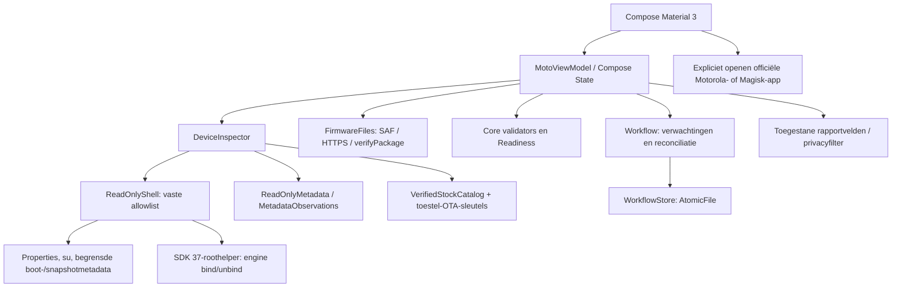

# Architectuur

## Modules

Het project heeft een platformonafhankelijke Kotlin/JVM-module `core` en een Android-appmodule `app`. De core bevat modellen, gereedheidsbeleid, firmwarevalidatie, back-upvalidatie, privacyfilters, transfercontracten en de duurzame workflow. De Android-module verzorgt Compose/Material 3, coroutines, bestandskiezer, echte uitleesprobes, toestelcertificaatverificatie, lokale bestanden en expliciete overdracht naar systeemapps.

Er is geen route in dit diagram van de app naar een partitieschrijver of rebootfunctie. Handelingen die de officiële apps buiten dit proces uitvoeren worden pas na onafhankelijke observatie in het logboek verwerkt.

## Toestel-, root- en snapshotinspectie

`ReadOnlyProbe` definieert de vaste diagnostische commando's. `ReadOnlyShell.property` accepteert alleen benoemde properties; een lege niet-geprivilegieerde waarde wordt pas na bevestigde rootverlening met root herlezen. Dit was op het echte toestel nodig voor Virtual A/B. De Magisk-bestandslezer accepteert uitsluitend een directory-ID met het exacte verwachte hashformaat. `ProcessBuilder` houdt stderr gescheiden en begrenst tijd en uitvoer. Een fout of afgekapte observatie wordt niet als geslaagd geparseerd.

`DeviceInspector` combineert afzonderlijke observaties tot `DeviceState` en een gedetailleerde `Inspection`. Echte metingen krijgen een tijdstip. Rootverlening, Magisk-code, apparaatprofiel, huidige slot, Virtual A/B, module-inventaris, accu en vrije opslag blijven zelfstandige gegevens. Snapshots en engine worden met `ObservationParsers` naar bekende categorieën vertaald; onbekende uitvoer blijft onbekend.

Op het onderzochte toestel ontbreken `bootctl`, `snapshotctl` en `update_engine_client`. De fallback leest precies 32 boot-controlbytes en 64 Virtual A/B-bytes uit `misc`; `ReadOnlyMetadata` controleert layout, magic, versie, omvang, CRC en slotgegevens. Snapshot-protobuf, bestandsaanwezigheid, consistente leeslengte, snapshotdirectory en Virtual A/B vormen afzonderlijke bronnen. Een aantoonbaar bestaand leeg proto3-bestand kan `NONE` betekenen; ontbrekende of onleesbare uitvoer kan dat niet. Ongeldige layouts en tegenstrijdige snapshot-/slotgegevens blijven onbekend.

De aparte `EngineProbe` wordt alleen op verzoek als rootproces uit de geïnstalleerde APK gestart. Zij vereist UID 0 en SDK 37, gebruikt beperkte `ServiceManager`-reflectie en accepteert alleen de werkelijk geladen frameworkbindings. De meegeleverde gepinde AIDL beschrijft het interfacecontract; transactienummers worden niet gegokt. Alleen `bind(callback)` en `unbind(callback)` worden aangeroepen. Callback- en procesdeadlines begrenzen ook een vastgelopen Binder-aanroep; geweigerde toegang of onbekende status blijft `UNKNOWN`. Er worden geen hidden-API-vrijstellingen of VM-/SELinux-beleidswijzigingen uitgevoerd. De werkelijke callback rapporteerde `IDLE`; dit is geen installatiefunctie.

Kernelbootconfig en userspacebeveiligingsproperties blijven apart bewaard. Op het echte toestel botsen `locked/green`-properties met `unlocked/orange` in de kernelbron. De mapper gebruikt de ondersteunde kernelbron en markeert het conflict expliciet; dit is geen hardwareattestatie. Private Motorola-prefs zijn optionele diagnose. Alleen twee vaste `cat`-probes gebruiken `su --target 0` voor de tijdelijke globale Magisk-mountnamespace; zij wijzigen geen bestand of permanent beleid.

## Firmware en back-ups

`FirmwareFiles` importeert een door de gebruiker gekozen content-URI naar de eigen appopslag of downloadt een toegestane HTTPS-kandidaat. Redirects zijn niet stilzwijgend toegestaan. Transfers hebben omvangslimieten en een tussenbestand; pas een afgeronde transfer wordt de geselecteerde lokale kopie. Er is geen import naar de Motorola-appmap.

`FirmwareValidator` onderzoekt ZIP-entries, metadata en payloadinhoud binnen grenzen. Hashintegriteit, buildcompatibiliteit en een afzonderlijk verstrekte authentificatiestatus zijn verschillende resultaten. `RecoverySystem.verifyPackage` wordt alleen in de Android-module aangeroepen tegen de echte systeemtruststore en installeert niets. Roottoegang of een testboolean in een unit-test mag een gewone echte ZIP niet authentiek maken.

`BackupValidator` onderzoekt volledige uitgepakte bytes, v4-init_boot-formaat, exact gemeten partitieomvang, gzip-CRC/trailer en hashes. Een back-updirectory alleen blijft onbewezen. `VerifiedStockCatalog` bevat nu één geauditeerde actuele referentie: de 8 MiB-stock17-image waarvan de SHA-256 overeenkomt met het onafhankelijk geauthenticeerde OTA-doelmanifest. Alleen het exacte gemeten toestelprofiel, Android-versie, build, fingerprint en een passende werkelijk gelezen toestel-OTA-SPKI activeren die referentie. Dan kan ook de echte Magisk-inventaris `provenanceVerified=true` krijgen na volledige bytevalidatie. Een andere build, sleutel of aliasfingerprint krijgt geen referentie. De huidige gepatchte partitie wordt niet tot stock gepromoveerd; er zijn geen stockimagebytes ingebouwd. Zie [het authenticiteitsbewijs](DEVICE-VALIDATION.md).

`MotorolaMetadataParser` leest begrensde XML en strikte JSON met duplicaat-, diepte- en omvangcontroles. De werkelijke envelop is een `downloadRequest`-object met een als JSON-string opgeslagen `contentResource`. De parser onderscheidt `METADATA_ONLY`, `OTA_ZIP` en `UNKNOWN`; de targetbuild komt uitsluitend uit het expliciete targetfingerprintveld. De aangetroffen `payload_metadata.bin`-job verwijst naar de al geïnstalleerde build en krijgt geen volledige OTA-downloadknop. Een officiële host alleen bewijst geen resourcesoort, authenticiteit of actueel aanbod. De gevoelige URL blijft uitsluitend in geheugen en veilige diagnostiek gebruikt enumwaarden.

Het onderzochte ondertekende pakket gebruikt verschillende OEM-fingerprintnamespaces en Android-labels. Een compleet payload-fingerprintpaar mag de informatieve doelweergave verbeteren, maar heft `OEM_METADATA_REVIEW_REQUIRED`, broncontroles of `ALREADY_INSTALLED` niet op. Er bestaat geen algemene aliasvertaalregel.

`OfficialApps` bouwt expliciete intents en start zelf niets. De updaterresolver gebruikt `MATCH_SYSTEM_ONLY`, positieve prioriteit en ingeschakelde geëxporteerde Motorola-systeemactivities. De actionstring is letterlijk vastgelegd voor compileSdk 35; de publieke Settings-constante bestaat pas vanaf 36.1. Ook de Magisk-launcher blijft aan zijn expliciete pakketcomponent gebonden. Ontbrekende geschikte apps leiden tot handmatige navigatie.

## Gereedheid

`Readiness.evaluate` maakt blockers en waarschuwingen uit dezelfde onveranderlijke `DeviceState`. Het specifieke toestelprofiel moet kloppen, beide init_boot-partities moeten bekend zijn en alleen onderzochte Magisk-compatibiliteit is aanvaardbaar. Snapshot NONE en engine IDLE zijn afzonderlijke eisen. Minimaal 50% accu en een conservatieve opslagraming zijn appbeleid, geen claim over Motorola's exacte engine-reservering.

De observaties moeten recent zijn en bij dezelfde sessie horen. Een onbekende bootidentiteit verhindert betrouwbaar herstel na een onverwachte herstart. Zelfs een resultaat zonder blockers is in deze release geen uitvoerrecht voor mutaties: de productadapter blijft uitsluitend uitlezend en begeleid.

De versiegrens voor begeleiding is Android 17 met Magisk 31.1. De ontgrendelde bootloader moet samenhangen met de waargenomen verified-bootstatus `orange`, de huidige slot moet succesvol gemarkeerd zijn en module-inventaris en rootcontrole moeten werkelijk zijn uitgevoerd. Deze conservatieve voorwaarden voorkomen dat een nieuw platform of onvolledige probe ongemerkt toestemming krijgt.

## Duurzame statusmachine

De workflow bewaart verwachte bron- en doelbuild, huidige en verwachte bootslot, pakket-SHA-256, een lokale bootidentificatie en module-/beveiligingsbaseline. Een opgeslagen fase is geen systeemmeting. Het logboek onderscheidt onder meer pakketonderzoek, wachten op stockherstel, wachten op OTA, waargenomen OTA-toepassing, Magiskrapportage, vereiste reboot, nieuwe targetboot, merge en eindcontrole.

`WorkflowStore` schrijft met Android `AtomicFile`: een mislukte write wordt teruggedraaid naar de vorige volledige toestand. De serialisatie heeft een schema. Onbekende of beschadigde opgeslagen gegevens leiden tot herstelcontrole. Simulaties mogen het echte logboek niet overschrijven.

Na heropenen reconciliëert `Workflow` de verwachtingen met nieuwe waarnemingen. Een processtop is geen systeemreboot. Een gewijzigde bootidentiteit triggert controle van build, slot, root en merge. Handmatige meldingen zijn expliciet gemarkeerd en kunnen nooit zelfstandig de eindstatus COMPLETE zetten. Rollback, verloren root, afwijkende slot en ontbrekende modules zijn afzonderlijke fouten; een niet-geïdentificeerde toestand wordt herstelvereist.

## Privacy en toestemmingen

Het manifest vraagt INTERNET voor een expliciet gestarte firmwaredownload en pakketzichtbaarheid voor de twee doelapps. Bestandsimport en export verlopen via Androids bestandskiezer. Er is geen brede opslagpermission, toegankelijkheidsservice, device-adminfunctie of bootontvanger die een update start. Android-appback-up staat uit.

Rapportage selecteert technische velden en gebruikt privacyfilters. De volledige `Inspection` met mogelijke ondertekende download-URL wordt niet als ruwe dump geëxporteerd. De app uploadt niets. Firmwarebestanden en het logboek blijven in de eigen appopslag tot de gebruiker die appgegevens verwijdert.

## Uitbreidingsregel

De opt-in toesteltest gebruikt daarnaast `FirmwareSignatureProbe` om een al aanwezige Motorola-ZIP rechtstreeks met Androids publieke signatureverificatie te controleren. Dit is een afzonderlijk SDK-37/rootproces met een strikte canonical-path-/omvangcontrole en watchdog. Geen bestand wordt gekopieerd of toegepast. De actuele positieve toesteltest staat in [het buildrapport](BUILD-REPORT.md).

Voeg een nieuw toestel of een nieuwe schrijfintegratie alleen toe met een eigen onderzocht adaptercontract en tests. Verander geen UNKNOWN-default in een optimistische waarde om de UI door te laten gaan. Houd externe API-contracten, lokale voorkeurbestanden, metadata-eigen verklaringen en onafhankelijke observaties gescheiden.
