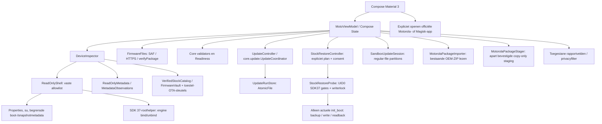

# Architectuur

## Modules

Het project heeft een platformonafhankelijke Kotlin/JVM-module `core` en een Android-appmodule `app`. De core bevat modellen, gereedheidsbeleid, firmwarevalidatie, back-upvalidatie, privacyfilters, transfercontracten en de duurzame workflow. De Android-module verzorgt Compose/Material 3, coroutines, bestandskiezer, echte uitleesprobes, toestelcertificaatverificatie, lokale bestanden en expliciete overdracht naar systeemapps.

Alleen de afzonderlijke, expliciet bevestigde stockherstelroute bereikt een partitie. Er is geen OTA-installer, Magisk-installer, slotwissel of rebootfunctie. Handelingen van de officiële apps worden apart als melding of onafhankelijke waarneming opgeslagen. De nieuwe live schrijver is nog niet op de telefoon uitgevoerd; de sandbox is het uitvoeringsbewijs voor de transactie.

## Toestel-, root- en snapshotinspectie

`ReadOnlyProbe` definieert de vaste diagnostische commando's. `ReadOnlyShell.property` accepteert alleen benoemde properties; een lege niet-geprivilegieerde waarde wordt pas na bevestigde rootverlening met root herlezen. Dit was op het echte toestel nodig voor Virtual A/B. De Magisk-bestandslezer accepteert uitsluitend een directory-ID met het exacte verwachte hashformaat. `ProcessBuilder` houdt stderr gescheiden en begrenst tijd en uitvoer. Een fout of afgekapte observatie wordt niet als geslaagd geparseerd.

`DeviceInspector` combineert afzonderlijke observaties tot `DeviceState` en een gedetailleerde `Inspection`. Echte metingen krijgen een tijdstip. Rootverlening, Magisk-code, apparaatprofiel, huidige slot, Virtual A/B, module-inventaris, accu en vrije opslag blijven zelfstandige gegevens. Snapshots en engine worden met `ObservationParsers` naar bekende categorieën vertaald; onbekende uitvoer blijft onbekend.

Op het onderzochte toestel ontbreken `bootctl`, `snapshotctl` en `update_engine_client`. De fallback leest precies 32 boot-controlbytes en 64 Virtual A/B-bytes uit `misc`; `ReadOnlyMetadata` controleert layout, magic, versie, omvang, CRC en slotgegevens. Snapshot-protobuf, bestandsaanwezigheid, consistente leeslengte, snapshotdirectory en Virtual A/B vormen afzonderlijke bronnen. Een aantoonbaar bestaand leeg proto3-bestand kan `NONE` betekenen; ontbrekende of onleesbare uitvoer kan dat niet. Ongeldige layouts en tegenstrijdige snapshot-/slotgegevens blijven onbekend.

De historische bootctl-enumnamen blijven voor fixtures bestaan, maar zijn runtime expliciet uitgeschakeld. Ook getters kunnen een boot-controlimplementatie initialiseren die metadata repareert; daarom start de app deze tool niet meer. De raw CRC-/kernelmetingen blijven de bron.

De aparte `EngineProbe` wordt alleen op verzoek als rootproces uit de geïnstalleerde APK gestart. Zij vereist UID 0 en SDK 37, gebruikt beperkte `ServiceManager`-reflectie en accepteert alleen de werkelijk geladen frameworkbindings. De meegeleverde gepinde AIDL beschrijft het interfacecontract; transactienummers worden niet gegokt. Alleen `bind(callback)` en `unbind(callback)` worden aangeroepen. Callback- en procesdeadlines begrenzen ook een vastgelopen Binder-aanroep; geweigerde toegang of onbekende status blijft `UNKNOWN`. Er worden geen hidden-API-vrijstellingen of VM-/SELinux-beleidswijzigingen uitgevoerd. De werkelijke callback rapporteerde `IDLE`; dit is geen installatiefunctie.

Kernelbootconfig en userspacebeveiligingsproperties blijven apart bewaard. Op het echte toestel botsen `locked/green`-properties met `unlocked/orange` in de kernelbron. De mapper gebruikt de ondersteunde kernelbron en markeert het conflict expliciet; dit is geen hardwareattestatie. Private Motorola-prefs zijn optionele diagnose. Alleen twee vaste `cat`-probes gebruiken `su --target 0` voor de tijdelijke globale Magisk-mountnamespace; zij wijzigen geen bestand of permanent beleid.

## Firmware en back-ups

`FirmwareFiles` importeert een door de gebruiker gekozen content-URI naar de eigen appopslag of downloadt een toegestane HTTPS-kandidaat. Redirects zijn niet stilzwijgend toegestaan. Transfers hebben omvangslimieten en een tussenbestand; pas een afgeronde transfer wordt de geselecteerde lokale kopie. Deze component schrijft niet naar Motorola's map. De aparte, afzonderlijk bevestigde `MotorolaPackageStager` kan een geauthenticeerde, gepinde ZIP met ondertekend bewezen reteu-kanaal daar copy-only klaarzetten; de mogelijke automatische herkenning door Motorola vereist een eigen waarschuwing. Zij roept geen installer aan en is nog niet fysiek gevalideerd. Zie [het stagingcontract](MOTOROLA_STAGING.md).

`MotorolaPackageImporter` leest in omgekeerde richting een reeds bestaande Motorola-ZIP, zodat de afgeschermde Android/data-map niet via SAF of een pc hoeft te worden geopend. De roothelper heeft een vaste UID0/SDK37/profileguard en bronmap, begrenst de bestandslijst en schrijft uitsluitend een unieke app-private stagingfile. De pure `MotorolaImportPolicy` controleert no-follow paden, bronidentiteit vóór/na, volledige SHA256 en readback. Alleen de app publiceert daarna onder `DownloadController.withPausedSelection` de selectie; een orphan rootcopy kan die selectie niet veranderen. De oorspronkelijke OEM-bron wordt niet gewijzigd.

`FirmwareValidator` onderzoekt ZIP-entries, metadata en payloadinhoud binnen grenzen. Hashintegriteit, buildcompatibiliteit en een afzonderlijk verstrekte authentificatiestatus zijn verschillende resultaten. `RecoverySystem.verifyPackage` wordt alleen in de Android-module aangeroepen tegen de echte systeemtruststore en installeert niets. Roottoegang of een testboolean in een unit-test mag een gewone echte ZIP niet authentiek maken.

`BackupValidator` onderzoekt volledige uitgepakte bytes, v4-init_boot-formaat, exact gemeten partitieomvang, gzip-CRC/trailer en hashes. Een back-updirectory alleen blijft onbewezen. `VerifiedStockCatalog` bevat nu één geauditeerde actuele referentie: de 8 MiB-stock17-image waarvan de SHA-256 overeenkomt met het onafhankelijk geauthenticeerde OTA-doelmanifest. Alleen het exacte gemeten toestelprofiel, Android-versie, build, fingerprint en een passende werkelijk gelezen toestel-OTA-SPKI activeren die referentie. Dan kan ook de echte Magisk-inventaris `provenanceVerified=true` krijgen na volledige bytevalidatie. Een andere build, sleutel of aliasfingerprint krijgt geen referentie. De huidige gepatchte partitie wordt niet tot stock gepromoveerd; er zijn geen stockimagebytes ingebouwd. Zie [het authenticiteitsbewijs](DEVICE-VALIDATION.md).

`PayloadManifest` parseert begrensde new-init_boot-informatie uit de geauthenticeerde payload. `FirmwareVault` bewaart deze ondertekende doelfeiten privé en bindt ze alleen na een verse werkelijke doelboot aan de gemeten systeemidentiteit. Een latere backup moet volledig matchen. Dit maakt volgende Android 17-builds mogelijk zonder één historische imagehash tot universele stockwaarheid te verheffen.

`MotorolaMetadataParser` leest begrensde XML en strikte JSON met duplicaat-, diepte- en omvangcontroles. De werkelijke envelop is een `downloadRequest`-object met een als JSON-string opgeslagen `contentResource`. De parser onderscheidt `METADATA_ONLY`, `OTA_ZIP` en `UNKNOWN`; de targetbuild komt uitsluitend uit het expliciete targetfingerprintveld. De aangetroffen `payload_metadata.bin`-job verwijst naar de al geïnstalleerde build en krijgt geen volledige OTA-downloadknop. Een officiële host alleen bewijst geen resourcesoort, authenticiteit of actueel aanbod. De parser logt of exporteert de gevoelige URL niet; een expliciet gestarte hervatbare download bewaart de referentie uitsluitend versleuteld met Android Keystore. Veilige diagnostiek gebruikt enumwaarden.

Het onderzochte ondertekende pakket gebruikt verschillende OEM-fingerprintnamespaces en Android-labels. Een compleet payload-fingerprintpaar mag de informatieve doelweergave verbeteren, maar heft `OEM_METADATA_REVIEW_REQUIRED`, broncontroles of `ALREADY_INSTALLED` niet op. Er bestaat geen algemene aliasvertaalregel.

`OfficialApps` bouwt expliciete intents en start zelf niets. De updaterresolver gebruikt `MATCH_SYSTEM_ONLY`, positieve prioriteit en ingeschakelde geëxporteerde Motorola-systeemactivities. De actionstring is letterlijk vastgelegd voor compileSdk 35; de publieke Settings-constante bestaat pas vanaf 36.1. Ook de Magisk-launcher blijft aan zijn expliciete pakketcomponent gebonden. Ontbrekende geschikte apps leiden tot handmatige navigatie.

## Gereedheid

`Readiness.evaluate` maakt blockers en waarschuwingen uit dezelfde onveranderlijke `DeviceState`. Het specifieke toestelprofiel moet kloppen, beide init_boot-partities moeten bekend zijn en alleen onderzochte Magisk-compatibiliteit is aanvaardbaar. Snapshot NONE en engine IDLE zijn afzonderlijke eisen. Minimaal 50% accu en een conservatieve opslagraming zijn appbeleid, geen claim over Motorola's exacte engine-reservering.

De observaties moeten recent zijn en bij dezelfde sessie horen. Een onbekende bootidentiteit verhindert betrouwbaar herstel na een onverwachte herstart. Een resultaat zonder blockers is geen schrijfrecht: de aparte `StockRestorePolicy` verlangt aanvullende verse metingen en een HMAC-gebonden eenmalige bevestiging voor een specifiek immutable plan.

De versiegrens voor begeleiding is Android 17 met Magisk 31.1. De ontgrendelde bootloader moet samenhangen met de waargenomen verified-bootstatus `orange`, de huidige slot moet succesvol gemarkeerd zijn en module-inventaris en rootcontrole moeten werkelijk zijn uitgevoerd. Deze conservatieve voorwaarden voorkomen dat een nieuw platform of onvolledige probe ongemerkt toestemming krijgt.

## Duurzame statusmachine

De workflow bewaart verwachte bron- en doelbuild, huidige en verwachte bootslot, pakket-SHA-256, een lokale bootidentificatie en module-/beveiligingsbaseline. Een opgeslagen fase is geen systeemmeting. Het logboek onderscheidt onder meer pakketonderzoek, wachten op stockherstel, wachten op OTA, waargenomen OTA-toepassing, Magiskrapportage, vereiste reboot, nieuwe targetboot, merge en eindcontrole.

`UpdateRunStore` schrijft met Android `AtomicFile`: een mislukte write wordt teruggedraaid naar de vorige volledige toestand. De serialisatie heeft een schema. Ook ontbrekende base met bestaande `.bak`, lege bestaande journals en te grote invoer worden behandeld. Onbekende of beschadigde gegevens leiden tot herstelcontrole. Simulaties hebben hun eigen directory en mogen het echte logboek niet overschrijven.

Na heropenen reconciliëert `UpdateCoordinator` de verwachtingen met nieuwe waarnemingen. Een processtop is geen systeemreboot. Een gewijzigde bootidentiteit triggert controle van build, slot, root en merge. De gedeclareerde doelfingerprint is optioneel; de werkelijk gemeten targetfingerprint wordt apart opgeslagen en niet naar een OEM-alias herschreven. Handmatige meldingen zijn expliciet gemarkeerd en kunnen nooit zelfstandig COMPLETE zetten. Rollback, verloren root, afwijkende slot en ontbrekende modules zijn afzonderlijke fouten; een niet-geïdentificeerde toestand wordt herstelvereist.

De officiële route kan met een werkelijk door Motorola aangeboden doelbuild zonder geïmporteerde ZIP beginnen. Een later geauthenticeerd pakket kan uitsluitend vóór de OTA en buiten een schrijver aan dezelfde doelbuild worden gekoppeld; de generieke compatibiliteitsblokkades blijven bestaan. Root- of module-eindcontrole kan na een herstelbare toestemmingsfout expliciet opnieuw worden gelezen; een OTA-/mergefout wordt daarmee niet gewist.

## Stocktransactie en simulatie

`StockRestoreController` serialiseert prepare/confirm/recover en claimt de verwachte workflow/transactie atomisch in het journaal vóór dispatch. De helper accepteert alleen vaste operaties en UUID's; app-private bron/request/key en het partitiedoel zijn intern afgeleid. De HMAC bindt bronidentiteit, boot-ID, slot, formaat, stockhash, huidige partitiehash en wallclock-/elapsedRealtime-termijnen. De helper meet zelf alle live gates, bewaart de volledige gepatchte partitie en verbruikt een `O_EXCL`-marker vóór schrijven. Alleen exact 8 MiB op de huidige init_boot van het onderzochte SDK37/Magisk31100-profiel wordt ondersteund.

De writerlock is ook verplicht voor uitlezende recovery. Na een crash wordt niets opnieuw geschreven. Stockherstel is pas bevestigd als actieve stockhash én volledige gepatchte backuphash kloppen. Als de bron nog volledig de oorspronkelijke gepatchte image is, kan een expliciete recovery alle gates lezen, de backup zo nodig vastleggen en het oude consent ongeldig maken. Pas daarna is een nieuwe transactie met nieuwe toestemming mogelijk. De helper heeft een eigen 55s deadline, maar vormt geen atomair interlock met de externe Motorola-updater; I/O-stalls blijven een herstelrisico.

`SandboxUpdateSession` gebruikt hetzelfde beleid en dezelfde fases met echte regular-file I/O. Stockrestore/backup/readback en het journaal zijn echte bestandsbewerkingen; OTA, Magisk, reboot, root en merge zijn mockobservaties. Alle staten houden `simulated=true`, en een bestaande sessie wordt niet automatisch herschreven. Zie [het volledige runbook](UPDATE-WORKFLOW.md).

## Privacy en toestemmingen

Het manifest vraagt INTERNET voor een expliciet gestarte firmwaredownload en pakketzichtbaarheid voor de twee doelapps. De beperkte PARTIAL_WAKE_LOCK rond een expliciet bevestigde stockdispatch heeft een timeout van 65 seconden en wordt in `finally` vrijgegeven; hij houdt het scherm niet aan. Bestandsimport en export verlopen via Androids bestandskiezer. Er is geen brede opslagpermission, toegankelijkheidsservice, device-adminfunctie of bootontvanger die een update start. Android-appback-up staat uit.

Rapportage selecteert technische velden en gebruikt privacyfilters. De volledige `Inspection` met mogelijke ondertekende download-URL wordt niet als ruwe dump geëxporteerd. De app uploadt niets. Firmwarebestanden en het logboek blijven in de eigen appopslag tot de gebruiker die appgegevens verwijdert.

## Uitbreidingsregel

De opt-in toesteltest gebruikt daarnaast `FirmwareSignatureProbe` om een al aanwezige Motorola-ZIP rechtstreeks met Androids publieke signatureverificatie te controleren. Dit is een afzonderlijk SDK-37/rootproces met een strikte canonical-path-/omvangcontrole en watchdog. Geen bestand wordt gekopieerd of toegepast. De actuele positieve toesteltest staat in [het buildrapport](BUILD-REPORT.md).

Voeg een nieuw toestel of een nieuwe schrijfintegratie alleen toe met een eigen onderzocht adaptercontract en tests. Verander geen UNKNOWN-default in een optimistische waarde om de UI door te laten gaan. Houd externe API-contracten, lokale voorkeurbestanden, metadata-eigen verklaringen en onafhankelijke observaties gescheiden.
