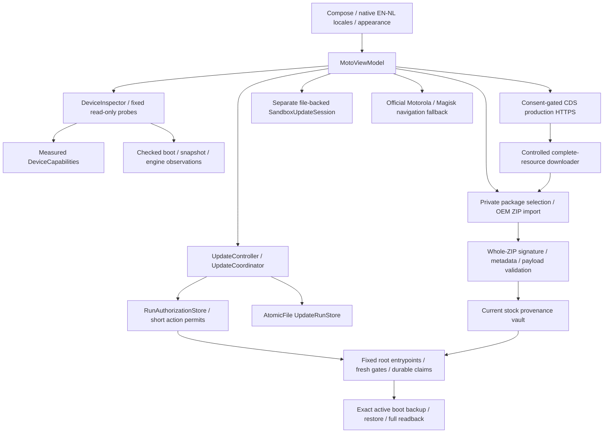

# Architecture — 1.0.1

The repository has a pure Kotlin/JVM `core` module and an Android `app` module. Policies and parsers do not depend on Android. Android adapters own transport, storage, system observations, privileged processes and UI. A UI state or saved journal cannot substitute for an observed operating-system result.

## Identity, observations and capabilities

`ReadOnlyProbe` and the property allowlist bound diagnostic commands. Shell output, elapsed time and byte counts are limited; stderr is separate from image bytes. Protected reads require an actual root grant. `DeviceInspector` combines independent values into `DeviceState` and `Inspection` without filling absent facts from marketing names or fixture defaults.

Measured manufacturer/model/device/channel, Android/build namespaces, boot ID, partition inventory, A/B layout, runtime root/Magisk, kernel security evidence, modules, battery and storage remain separate observations. `DeviceCapabilities` grants narrower capabilities as proof becomes available; the historical `merc` profile is not a universal-model requirement. Unsupported critical runtimes remain blocked while diagnostics can still work.

CRC-checked boot-control and Virtual A/B metadata, snapshot protobuf/directory observations and actual engine callbacks determine state. Traditional A/B can be positively not applicable for snapshot merging; unknown Virtual A/B cannot. The runtime does not invoke `bootctl` getters: their implementation can initialize or repair metadata. `EngineProbe` uses reviewed framework Binder definitions and actual bind/unbind callbacks, without guessed transaction numbers, hidden-API exemptions or SELinux changes. [Compatibility](COMPATIBILITY.md).

## Discovery, transfer and authentication

`CdsController` obtains separate online consent before reading identifiers or sending production HTTPS. A dedicated reader keeps serial/GUID outside ordinary diagnostics and export. Strict bounded JSON, current context, target and resource binding govern an offer. The opaque live selection evidence is separate from an OEM package signature or install permit. [CDS provider](CDS-PROVIDER.md).

The downloader stores sensitive references separately, persists resumable jobs and only publishes complete selected bytes under the shared selection lock. Private pinning provides stable validation input, using a durable copy fallback when hardlinks are denied. Existing OEM ZIP import reads a restricted source and writes a unique private staging file; it does not alter the original. The legacy optional OEM staging route has its own signed-channel and no-clobber publication contract. [Monitoring and downloads](MONITORING-AND-DOWNLOADS.md), [staging](MOTOROLA_STAGING.md).

`FirmwareValidator` checks bounded ZIP structures, metadata, payload headers/hashes and projected boot manifests. `RecoverySystem.verifyPackage` supplies actual device-trust authentication in the Android layer. Byte integrity, authenticated signature, source compatibility, channel and image provenance are distinct results.

`BootImageStreams` processes raw/gzip images with bounded buffers, full SHA1/SHA256, gzip CRC/size/trailer checks and reviewed AOSP boot-header layouts. It distinguishes `boot` and `init_boot`; size and type come from actual evidence. `FirmwareVault` binds OEM-authenticated manifest digests to current image identity, measured trust anchors and independent live Magisk association. [Stock provenance](STOCK-PROVENANCE.md).

## Workflow and privileged boundaries

`UpdateRunStore` uses `AtomicFile` for the persistent journal. Missing, corrupt, stale, user-reported and verified facts are distinct. Source/target identities, expected slots, source boot, package hash, security/module baselines and image evidence are durable. Reconciliation reads actual state after restart and detects target boot, incomplete merge, root denial/loss and possible rollback.

`RunAuthorizationPolicy` binds one initial intent to exact device/source/target/package/actions and independent wall-clock/elapsed deadlines. The store narrows an unknown package only to matching authenticated bytes and issues bounded short permits for the active session. App-dispatch and root-consumption markers are separate, durable and one use. Recreating a store does not reactivate a saved run for mutation.

`StockRestoreController` and the fixed root helper derive all transaction paths internally. They require authenticated current bytes and fresh safety gates, copy/hash the full patched source, recheck immediately before the write, consume authority, synchronize and read back the entire partition. Only the measured active `boot` or `init_boot` A/B partition is eligible. Streaming bounds avoid assuming every model has an 8 MiB image.

The exclusive writer lock also applies to read-only recovery. Interrupted work is observed, never silently replayed or rolled back. It cannot lock Motorola's external updater or defeat power/storage failure. Scope MACs protect the app-to-helper contract, not against a separate adversary with full root. [Workflow](UPDATE-WORKFLOW.md), [Safety](SAFETY.md).

## Presentation, privacy and simulation

Compose Material3 provides overview, firmware, update, diagnostics and settings destinations, adaptive navigation, a first-run tour and system/light/dark appearance. Android 13+ `LocaleManager` manages English/Dutch per-app language. Typed presentation keys resolve cached observations in the current locale; raw saved legacy prose is not a translated UI message. Notification channels are refreshed after language changes.

Reports export an allowlist on request. Android backup/transfer are disabled; no automatic diagnostic upload or IMEI collection occurs. Explicit online discovery and downloads disclose their network data. Release signing material stays outside the checkout; production is non-debuggable with dynamic root/JNI/Binder/Worker contracts checked in the actual APK. Version 1.0.0 retains the complete runtime; optional shrinking needs separate qualification. [Release engineering](RELEASE-ENGINEERING.md).

`SandboxUpdateSession` has a separate journal and regular-file partitions. Its OTA/Magisk/slots/root/reboot/merge are explicitly simulated. It exercises real file transaction and failure logic, cannot authorize live actions and does not change the live journal. Current executions belong in [BUILD-REPORT](BUILD-REPORT.md); historical hardware qualification is labelled separately.
