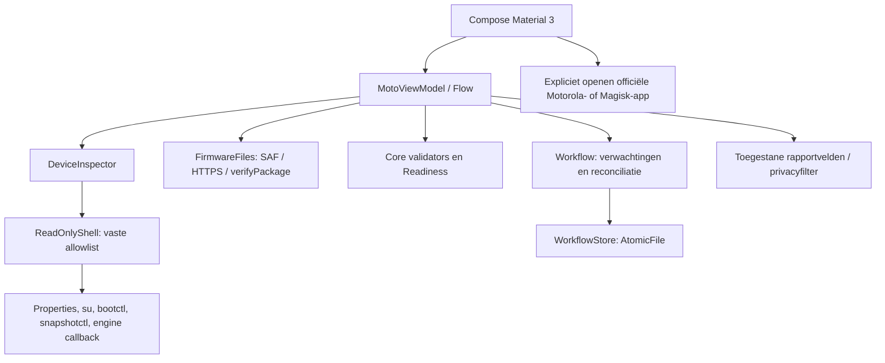

# Architectuur

## Modules

Het project heeft een platformonafhankelijke Kotlin/JVM-module `core` en een Android-appmodule `app`. De core bevat modellen, gereedheidsbeleid, firmwarevalidatie, back-upvalidatie, privacyfilters, transfercontracten en de duurzame workflow. De Android-module verzorgt Compose/Material 3, coroutines, bestandskiezer, echte uitleesprobes, toestelcertificaatverificatie, lokale bestanden en expliciete overdracht naar systeemapps.

Er is geen route in dit diagram van de app naar een partitieschrijver of rebootfunctie. Handelingen die de officiële apps buiten dit proces uitvoeren worden pas na onafhankelijke observatie in het logboek verwerkt.

## Toestel-, root- en snapshotinspectie

`ReadOnlyProbe` definieert de volledige lijst toegestane commando's. `ReadOnlyShell.property` accepteert alleen benoemde properties. De aanvullende Magisk-bestandslezer accepteert uitsluitend een directory-ID met het exacte verwachte hashformaat; geen vrij pad. `ProcessBuilder` voert de vaste opdracht uit, houdt stderr gescheiden en begrenst tijd en uitvoer. Een fout of afgekapte observatie wordt niet als geslaagd geparseerd.

`DeviceInspector` combineert afzonderlijke observaties tot `DeviceState` en een gedetailleerde `Inspection`. Echte metingen krijgen een tijdstip. Rootverlening, Magisk-code, apparaatprofiel, huidige slot, Virtual A/B, module-inventaris, accu en vrije opslag blijven zelfstandige gegevens. Snapshots en engine worden met `ObservationParsers` naar bekende categorieën vertaald; onbekende uitvoer blijft onbekend.

De engineprobe abonneert zich tijdelijk op callbacks; zij gebruikt geen installatie- of cleanupflag. Snapshotdump en HAL-status worden als verschillende bronnen behandeld. Bij ontbreken of tegenspraak moet de veiligste interpretatie worden behouden. Het uitlezen van private Motorola-prefs is een optionele, fouttolerante diagnose; de app wijzigt deze bestanden niet.

## Firmware en back-ups

`FirmwareFiles` importeert een door de gebruiker gekozen content-URI naar de eigen appopslag of downloadt een toegestane HTTPS-kandidaat. Redirects zijn niet stilzwijgend toegestaan. Transfers hebben omvangslimieten en een tussenbestand; pas een afgeronde transfer wordt de geselecteerde lokale kopie. Er is geen import naar de Motorola-appmap.

`FirmwareValidator` onderzoekt ZIP-entries, metadata en payloadinhoud binnen grenzen. Hashintegriteit, buildcompatibiliteit en een afzonderlijk verstrekte authentificatiestatus zijn verschillende resultaten. `RecoverySystem.verifyPackage` wordt alleen in de Android-module aangeroepen tegen de echte systeemtruststore en installeert niets. Roottoegang of een testboolean in een unit-test mag een gewone echte ZIP niet authentiek maken.

`BackupValidator` onderzoekt uitgepakte bytes, imageformaat, omvang en bewijsgegevens. De echte Magisk-inventaris kan kandidaatbestanden vinden en gzip/hashcorrespondentie onderzoeken. `provenanceVerified` blijft voor zulke automatisch gevonden bestanden standaard onwaar: een back-updirectory is geen firmware-attestatie. De huidige gepatchte image wordt nergens automatisch tot stock gepromoveerd.

## Gereedheid

`Readiness.evaluate` maakt blockers en waarschuwingen uit dezelfde onveranderlijke `DeviceState`. Het specifieke toestelprofiel moet kloppen, beide init_boot-partities moeten bekend zijn en alleen onderzochte Magisk-compatibiliteit is aanvaardbaar. Snapshot NONE en engine IDLE zijn afzonderlijke eisen. Minimaal 50% accu en een conservatieve opslagraming zijn appbeleid, geen claim over Motorola's exacte engine-reservering.

De observaties moeten recent zijn en bij dezelfde sessie horen. Een onbekende bootidentiteit verhindert betrouwbaar herstel na een onverwachte herstart. Zelfs een resultaat zonder blockers is in deze release geen uitvoerrecht voor mutaties: de productadapter blijft uitsluitend uitlezend en begeleid.

De versiegrens voor begeleiding is Android 17 met Magisk 31.1. De ontgrendelde bootloader moet samenhangen met de waargenomen verified-bootstatus `orange`, de huidige slot moet succesvol gemarkeerd zijn en module-inventaris en rootcontrole moeten werkelijk zijn uitgevoerd. Deze conservatieve voorwaarden voorkomen dat een nieuw platform of onvolledige probe ongemerkt toestemming krijgt.

## Duurzame statusmachine

De workflow bewaart verwachte bron- en doelbuild, huidige en verwachte bootslot, pakket-SHA-256, een lokale bootidentificatie en module-/beveiligingsbaseline. Een opgeslagen fase is geen systeemmeting. Het logboek onderscheidt onder meer pakketonderzoek, wachten op stockherstel, wachten op OTA, waargenomen OTA-toepassing, Magiskrapportage, vereiste reboot, nieuwe targetboot, merge en eindcontrole.

`WorkflowStore` schrijft met Android `AtomicFile`: een mislukte write wordt teruggedraaid naar de vorige volledige toestand. De serialisatie heeft een schema. Onbekende of beschadigde opgeslagen gegevens leiden tot herstelcontrole. Simulaties mogen het echte logboek niet overschrijven.

Na heropenen reconciliëert `Workflow` de verwachtingen met nieuwe waarnemingen. Een processtop is geen systeemreboot. Een gewijzigde bootidentiteit triggert controle van build, slot, root en merge. Handmatige meldingen zijn expliciet gemarkeerd en kunnen nooit zelfstandig de eindstatus COMPLETE zetten. Rollback, verloren root, afwijkende slot en ontbrekende modules zijn afzonderlijke fouten; een niet-geïdentificeerde toestand wordt herstelvereist.

## Privacy en toestemmingen

Het manifest vraagt INTERNET voor een expliciet gestarte firmwaredownload en pakketzichtbaarheid voor de twee doelapps. Bestandsimport en export verlopen via Androids bestandskiezer. Er is geen brede opslagpermission, toegankelijkheidsservice, device-adminfunctie of bootontvanger die een update start. Android-appback-up staat uit.

Rapportage selecteert technische velden en gebruikt privacyfilters. De volledige `Inspection` met mogelijke ondertekende download-URL wordt niet als ruwe dump geëxporteerd. De app uploadt niets. Firmwarebestanden en het logboek blijven in de eigen appopslag tot de gebruiker die appgegevens verwijdert.

## Uitbreidingsregel

Voeg een nieuw toestel of een nieuwe schrijfintegratie alleen toe met een eigen onderzocht adaptercontract en tests. Verander geen UNKNOWN-default in een optimistische waarde om de UI door te laten gaan. Houd externe API-contracten, lokale voorkeurbestanden, metadata-eigen verklaringen en onafhankelijke observaties gescheiden.
